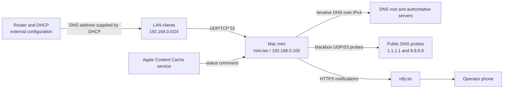
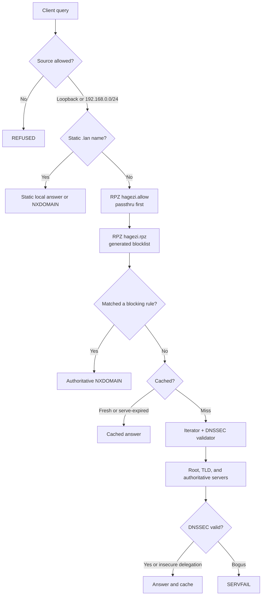
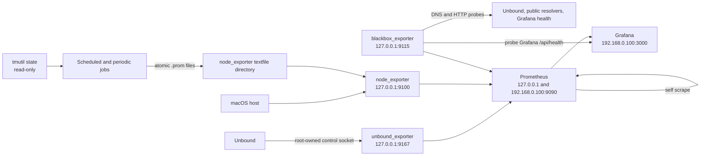
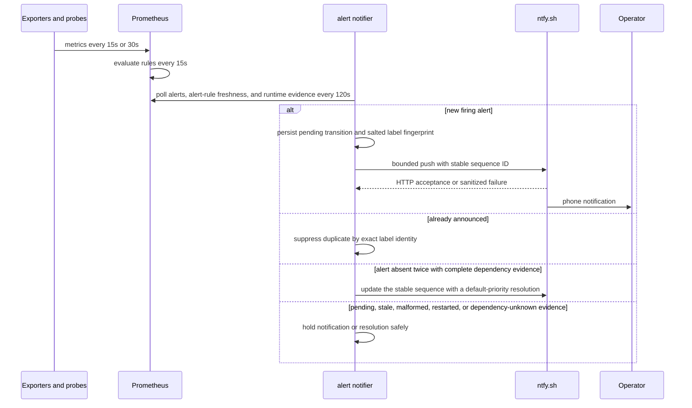

# Architecture

## Scope

The system is a recursive DNS resolver and monitoring stack on one Mac mini. The host
has two roles:

1. serve DNS policy for `192.168.0.0/24`; and
2. observe its own DNS, host, automation, and Apple Content Cache state.

The single-host design keeps dependencies small, but it also makes host power, macOS,
the Ethernet path, and the WAN shared failure domains. Router DHCP configuration is an
external dependency. The repository does not configure the router.

## System context



The documented DHCP fallback `9.9.9.9` is not enforced by this repository. Operators
SHOULD verify the router before relying on it. A fallback keeps public DNS available
during a mini outage but bypasses RPZ policy and `.lan` data.

## DNS request flow



Unbound binds `127.0.0.1:53` and `192.168.0.100:53` for UDP and TCP. It uses IPv4
transport only. The `respip validator iterator` module order applies response policy,
DNSSEC validation, and recursion. Query and reply logging are disabled; RPZ action
logging remains enabled.

### Policy order

| Order | Zone | Runtime file | Effect |
|---:|---|---|---|
| 1 | `hagezi.allow` | `/opt/homebrew/etc/unbound/blocklists/hagezi-allow.rpz` | `rpz-passthru` exceptions override the blocklist |
| 2 | `hagezi.rpz` | `/opt/homebrew/etc/unbound/blocklists/hagezi-normal.rpz` | Generated list, forced NXDOMAIN |

The tracked selector is `hagezi-normal`. If the selector file is empty or absent, the
updater falls back to `hagezi-normal`.

## Monitoring pipeline



Prometheus scrapes eight target instances across seven jobs: Unbound, Prometheus,
node_exporter, two upstream blackbox targets, one resolver probe, one RPZ canary, and one
Grafana HTTP/database probe. The two upstream targets share one Prometheus job. The
2026-07-14 audit removed the direct Grafana `/metrics` scrape because its 5,790 samples
per 15-second scrape were unused; the health probe answers the actual operational
question with far lower ingestion cost.

### Active probes

| Job | Module | Target | What it proves | What it does not prove |
|---|---|---|---|---|
| `blackbox_upstream` | `dns_upstream` | `1.1.1.1`, `8.8.8.8` | UDP/53 can reach public resolvers | Unbound recursion itself is healthy |
| `blackbox_resolver` | `dns_resolver` | `192.168.0.100` | Unbound answers a hot query | Fresh recursion works; cache and serve-expired can mask failure |
| `blackbox_rpz_canary` | `dns_rpz_canary` | `192.168.0.100` | `google-analytics.com` is blocked as NXDOMAIN | Every client is using the mini |
| `blackbox_grafana` | `http_grafana_health` | Grafana `/api/health` | HTTP is reachable and Grafana reports database `ok` | Dashboard rendering or every panel query is correct |

### Recording and dashboard layer

Prometheus evaluates 11 canonical recording rules every 15 seconds. They own target
inventory/collection health, notifier health, upstream success, Unbound activity/cache
ratio, and Content Cache traffic fractions. Missing inputs remain empty except for
counts where a successful Prometheus query and a separate inventory signal make zero
unambiguous.

Five file-provisioned Grafana dashboards consume the datasource UID `prometheus`:

```text
Operational Overview
  -> DNS and Unbound
  -> Host, Services, and Backups
  -> Apple Content Cache
  -> Prometheus Diagnostics
```

The provider rejects UI-only saves. The generator and checked-in JSON are the complete
repository source; Grafana's database is not an authoring surface.

## Alert pipeline



There is no Alertmanager. `prometheus_alert_notifier.py` observes pending and firing
alerts but publishes only firing transitions. It verifies the alerts API against fresh
alert-rule evaluation timestamps and Prometheus runtime evidence. Exact sorted labelsets
are identified by a per-state-file salted HMAC; raw private labels are not stored as
keys. Notification bodies admit only `job`, `exported_job`, `instance`, `mountpoint`,
`task`, `file`, `rule_group`, and `fstype`; file paths become basenames and private
non-system mountpoints become a generic filesystem marker. Annotations and every other
label remain local. Missing severity and `warning` map to high priority; `critical` maps
to urgent.

The state directory is mode 0700; the durable JSON state and advisory overlap lock are
mode 0600. State and textfile replacements are fsynced and atomically renamed. A new or
invalid state file adopts the current firing set as a no-replay baseline, preventing a
restart or corruption storm. A normal first firing is persisted before HTTP. A stable
ntfy sequence ID makes a retry update the same client notification after a crash, but
ntfy keeps append-only server events; transactional exactly-once HTTP delivery is not
claimed.

A missing firing identity is eligible to resolve only after two complete polls, after a
ten-minute Prometheus-restart grace, and while its explicit collection dependencies are
not pending or firing. API failure, stale rule evaluation, malformed entries, target
inventory mismatch, node/textfile failure, blackbox failure, and Unbound-exporter
failure therefore hold affected resolutions instead of converting UNKNOWN into
RESOLVED. Permanent ntfy 4xx errors are not retried; 429 and transient failures use
bounded attempts and bounded `Retry-After` deferral. At most ten transitions are sent in
one run.

The notifier can report unavailable or stale Prometheus alert-state evidence directly
after three failed/incomplete polls. It cannot report its own complete death.
`AlertNotifierStale`, processing/persistence metrics, and `NtfyDeliveryFailures`
therefore remain dashboard-visible tripwires with a circular notification limitation.
An ntfy HTTP 2xx proves server acceptance only; phone receipt is explicitly UNKNOWN.

## Ownership and privilege boundaries

| Component | launchd identity | Effective runtime privilege | Reason |
|---|---|---|---|
| `homebrew.mxcl.unbound` | root service definition | Unbound drops to user `unbound` | Port 53, config ownership, control socket |
| `local.unbound.exporter` | root | root | Reads the root-owned Unbound control socket |
| `local.unbound.blocklist` | root | root | Executes root-owned libexec code, replaces Unbound-owned zones and reloads RPZ zones |
| `local.unbound.roothints` | root | root | Executes root-owned libexec code and replaces root hints under `/opt/homebrew/etc/unbound` |
| `local.unbound.warmboot` / `warmlist` | root | root | Executes root-owned libexec code and uses the control socket |
| Prometheus, Grafana, node_exporter, blackbox | `localadmin` | unprivileged admin account | No control-socket access required; starts at boot without GUI login |
| Content-cache, clientstats, Time Machine, alert notifier | `localadmin` | unprivileged admin account | Read-only source APIs plus textfile writes or outbound HTTPS |

All custom executable code is root-owned under `/usr/local/libexec/unbound-stack`, even
when a LaunchDaemon drops to `localadmin`. Root jobs MUST NOT execute user-writable
code. The textfile directory is group-writable so `localadmin` jobs can publish metrics. This
is an accepted trust boundary: any process in the `admin` group can write a well-formed
metric that alert rules trust. `node_textfile_scrape_error` detects malformed files, not
fabricated valid values.

## Network and security boundaries

- DNS is exposed only on loopback and Ethernet LAN addresses.
- Prometheus is exposed on loopback and the Ethernet LAN address.
- Grafana is exposed only on the Ethernet LAN address.
- Exporters are loopback-only.
- SSH is configured for public-key authentication only.
- Screen Sharing is disabled by default and enabled only through the root-owned helper.
- Tailscale/MagicDNS is an operating-system function; Unbound MUST NOT forward the
  tailnet zone or claim the `100.64.0.0/10` reverse space.
- The ntfy topic is the channel credential. Repository tools MUST NOT read, hash, or
  print it; the deployment verifier checks only existence and metadata.
- The macOS application firewall associates allows with resolved Cellar binary paths.
  Prometheus and Grafana SHOULD be re-authorized after Homebrew upgrades.

## Failure domains

| Domain | Effect | Detection | Containment |
|---|---|---|---|
| Unbound process/config | LAN DNS policy unavailable; clients may use external fallback | Resolver probe, `UnboundDown`, process state | Validate before reload; KeepAlive; warm cache after restart |
| WAN or UDP/53 path | Cache misses stall or fail while cached answers may remain fast | Upstream probes, degraded/down alerts, request-list depth | Do not edit Unbound; troubleshoot router/modem/ISP |
| RPZ data/update | Blocking may stop, overblock, or use stale data | Canary, size and freshness alerts | Atomic swap, rollback, allowlist first |
| Mac mini host/power | DNS, exporters, Prometheus, Grafana, rules, and notifier fail together | No independent automated witness is deployed; manual external client test only | Add an external dead-man/DNS witness; router fallback and full rebuild documentation |
| Prometheus | Dashboards and rule evaluation stop | Direct notifier unreachable path | Notifier sends a direct outage notification after repeated failures |
| Grafana | Visualization unavailable; collection continues | Blackbox `/api/health` probe and `GrafanaDown` | Prometheus UI and APIs remain available |
| blackbox_exporter | Every DNS and Grafana synthetic result disappears together | `BlackboxExporterDown`, target history | Inspect exporter before attributing simultaneous probe loss to all targets |
| node_exporter | Host and all eight custom textfile outputs disappear together | `NodeExporterDown`, collection coverage | Inspect shared exporter before individual producer alerts |
| node_exporter textfiles | Job metrics missing or malformed | mtime/breadcrumb alerts, `TextfileScrapeError` | Atomic producers; missing-series alerts |
| ntfy or notifier | Phone delivery stops | notifier metrics and dashboard-only alerts | Local Prometheus alerts remain queryable |
| Router DHCP/client selection | Clients bypass policy or lose `.lan` | Client-side resolver inspection only | Verify router and clients; dashboards cannot prove client selection |

## Data lifecycle

| Data | Persistence | Repository status |
|---|---|---|
| Intended configuration and scripts | Git history | Tracked |
| Generated RPZ blocklists | Refreshed daily | Not tracked |
| Personal warm list | Regenerated from cache; privacy-sensitive | Not tracked |
| Prometheus TSDB | 90-day runtime retention | Not tracked |
| Grafana users/sessions/database | Runtime state | Not tracked |
| Notifier salted fingerprints, transitions, and counters | Runtime state, private mode | Not tracked |
| Time Machine state and latest-backup timestamp | Recomputed every 15 minutes; destination identifiers omitted | Generated textfile, not tracked |
| ntfy topic | Persistent secret, mode 600 | MUST NOT be tracked |
| Root trust anchor | Managed by Unbound | Not tracked |

See [REFERENCE.md](REFERENCE.md) for exact paths and [DISASTER-RECOVERY.md](DISASTER-RECOVERY.md)
for recovery consequences.
