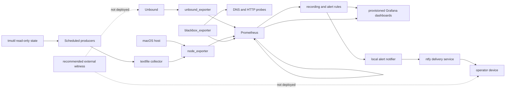

# Monitoring dashboard audit and reimplementation — 2026-07-14

This report separates three states:

- **Observed live** means read-only evidence collected from the Mac mini, Prometheus,
  Grafana's database/API, exporter output, launchd state, or a live canary on 2026-07-14.
- **Observed repository** means evidence in Git baseline
  `b91a7d02e24c1df02cd6d213dc4dc2736d280bbf` or the working tree.
- **Candidate** means the repository-controlled redesign in this working tree. It has
  not been deployed, provisioned, reloaded, restarted, committed, or pushed.

The exact inherited 95-panel inventory, including every old expression, transformation,
reducer, source family/type, unit, threshold, variable, correctness classification,
disposition, and evidence, is
[monitoring-dashboard-panel-inventory-2026-07-14.csv](monitoring-dashboard-panel-inventory-2026-07-14.csv).
It is generated reproducibly from the audited Git baseline by
`tools/generate-monitoring-audit-inventory.py`.

## Executive summary

The inherited interface was not trustworthy as a whole. Fifty stat panels executed
range queries and reduced them with `lastNotNull`, allowing an old healthy value to
survive current source loss. The seven dashboards also contained two mathematically
incorrect disk forecasts, a false macOS “memory pressure” formula, an unverified
Tailscale attribution, incomplete Content Cache ratios, low-traffic ratio errors,
stale Time Machine mount inference, arbitrary severity colors, duplicated panels, and
no active-alert, notifier, backup-success, or independent-outage view.

The baseline classification is: 30 correct, 29 technically correct but poorly
presented, 20 misleading, 6 semantically incorrect, 2 mathematically incorrect,
6 redundant, 1 decorative, and 1 unverifiable. Disposition is 17 retain, 9 rewrite,
8 redesign, 8 merge, 6 move to drill-down, 6 replace, 1 rename, and 40 remove.

The candidate retains Grafana. It replaces seven dashboards/95 data panels with five
dashboards/83 Grafana objects: 14 open row headers and 69 data or text panels. The
like-for-like reduction is 95 to 69 operational panels (27%). Four dashboard files and
40 inherited panels are removed. All current-value queries are explicitly instant-only;
historical queries are explicitly range-only. Missing, stale, disabled, low-traffic,
and no-current-series states are either directly mapped or resolved by an adjacent
freshness/configuration state.

Grafana was retained because the verified problems are query semantics, stale reducers,
missing failure-domain metrics, information architecture, and provisioning discipline;
Grafana 13 can solve all of them. Perses is the strongest future challenger, but a
replacement would add a second UI/runtime and migration risk without fixing the shared
Mac/LAN/Prometheus failure domain. The selected architecture is **Grafana plus a
recommended independent external outage witness**. The witness is intentionally marked
`NOT DEPLOYED`; no external service or secret was created.

The replacement is deployed from commit
`408c825ce3af41a0dad95924a8d7cf34dbe9fa70`. Exact target-native validation passed all
72 tests, including the 11 Bash-dependent cases unavailable on the workstation; all 151
dashboard/rule expressions parsed and executed at every required range; and Grafana
provisioned exactly five UIDs. Rendered QA at 1440×900 and 1024×768 found no first-screen
title overflow, query, datasource, or transformation error after the responsive health
rows were corrected. The result is trustworthy with the limitations documented below,
most importantly the absence of an independent external outage witness.

## Existing architecture

### Discovered stack

| Layer | Observed live state |
|---|---|
| Resolver | Unbound with root control socket; `unbound_exporter` 0.6.0 exposes control statistics |
| Host/custom metrics | node_exporter running 1.11.1 (1.12.1 installed); textfiles from blocklist, warm-list, root-hints, warmboot, client/RPZ, Content Cache, and notifier jobs |
| Synthetic checks | blackbox_exporter 0.28.0; two public UDP/53 targets, LAN resolver probe, and RPZ NXDOMAIN canary |
| Prometheus | Running 3.13.0 (3.13.1 installed), 15 s global scrape/evaluation, 30 s probes, seven static-discovery jobs/eight target instances, no service discovery beyond static targets |
| Rules | 29 inherited alerts, no recording rules, no Alertmanager, zero firing alerts during audit |
| Grafana | 13.1.0, datasource UID `prometheus`, seven root-folder file-provisioned dashboards, provider `unbound`, no Grafana-managed alerts |
| Plugins | `zipkin` 12.4.5, `elasticsearch` 12.6.5, Logs Drilldown 2.2.0, Metrics Drilldown 2.2.0, Traces Drilldown 2.1.0, Pyroscope 2.1.0; none is required by the dashboards |
| Notification | Local notifier polls Prometheus every 120 s and sends firing/resolved events through ntfy; no Alertmanager |
| Storage | Prometheus configured for 90 d but retained about 10.2 d during audit; TSDB about 831 MiB and Grafana database about 111 MiB |

The live dashboard resources exactly matched the seven repository JSON definitions by
UID and content. No manual/dashboard-database divergence, non-root dashboard folder,
library panel, annotation, snapshot, public dashboard, or Grafana alert was found. The
only variable was a rolling client selector on `unbound-dns`; the inherited dashboards
had no navigation links or dashboard descriptions.

Custom update cadences were verified as Content Cache 300 s, client/RPZ 120 s,
notifier 120 s, Time Machine not yet instrumented, daily blocklist/warm-list,
monthly root hints, and boot-time cache warming. Refreshing the old Content Cache
dashboard every 60 s could not create fresher five-minute source data.

### Architecture map



### Shared failure domains

| Failure domain | What disappears or degrades together | Surviving evidence |
|---|---|---|
| Mac mini power/host failure | Unbound, all exporters, Prometheus, Grafana, local rule evaluation, notifier, local history access | Router fallback may preserve public DNS while bypassing local policy; no independent monitoring witness exists |
| Residential LAN/router failure | Client access to Unbound/Grafana/Prometheus and local probes; notifier may still run if WAN survives | No outside-in LAN reachability witness |
| WAN/ISP/UDP 53 failure | Fresh recursion paths and ntfy delivery; cached/serve-expired answers may continue | Local host/exporter state and cached resolver probe can remain green |
| Prometheus failure | Ingestion, recording/alert evaluation, dashboards' data, notifier polling | Exporters continue exposing current values; no independent recorder/alerter |
| Grafana failure | Dashboard UI only | Prometheus, rules, notifier, and API remain available |
| node_exporter failure | Host metrics and every custom textfile family disappear together | Unbound exporter, Prometheus, and blackbox paths remain; candidate adds one shared-path alert and suppresses producer alert fan-out |
| blackbox_exporter failure | Every `probe_success` path disappears together | Direct Unbound/exporter/host metrics remain; candidate separates scrape state from target state |
| notifier/ntfy failure | Phone delivery is absent or circularly unreportable | Prometheus/Grafana expose notifier freshness and delivery counters locally |

## Important defects

Only verified defects are listed, ordered by incident impact.

| Affected component | Incorrect behavior and evidence | Operational consequence | Correction |
|---|---|---|---|
| 50 inherited stat panels | Every stat was a range query reduced by `lastNotNull`; no stat used instant mode | A stopped exporter or vanished series could leave an old green/current-looking value | Candidate sets `instant:true, range:false` on every stat/ranking/table query and `instant:false, range:true` on historical panels |
| Whole local stack | Mac/LAN/Prometheus loss removes resolver, monitoring, rule evaluation, UI, and notification; no off-host witness was found | Complete outages can be silent or indistinguishable from the UI being unreachable | First screen states the gap; recommend one external DNS/dead-man witness on a separate failure domain |
| Target and exporter inventory | `sum(1-up)` and `count(up)` could not detect a removed job; no node/blackbox shared-path alert existed | Missing monitoring could look like zero failures and individual probes/producers could be misdiagnosed | Exact per-job/total cardinality record, node/blackbox/self-scrape/probe-result alerts, and unknown-on-inventory-mismatch behavior |
| Storage & Backups panels 3, 6, 8, 9, 11 | Transient `/Volumes` state was treated as backup health; live 7 d data contained 166 historical device/mount series. Forecast gates were wrong: 1,000 samples at 15 s is about 4 h 10 m, not 15 m; 12,000 is about 50 h, not 3 d | Old mounts could look current; unsupported forecasts could prompt bad action; no backup completion was proven | Remove mount inference/forecast cards; add privacy-preserving read-only Time Machine metrics and current-only filesystem ranking |
| System Stats panel 3 | `(active+wired)/total` was labeled macOS memory pressure | Normal macOS memory accounting could be reported as pressure | Remove claim; show raw active/wired/compressed/free gauges neutrally |
| Unbound cache ratio panel | Hits were divided by `clamp_min(total,1)`; for real rates below 1/s the ratio was depressed even though the panel's gate allowed display | Low traffic could appear as poor cache behavior | Canonical 15 m numerator/denominator ratio, empty at ≤1 lookup/s; UI maps a separate neutral LOW TRAFFIC state |
| Content Cache ratio panels 19, 23, 25 | Denominators omitted parent/peer traffic and/or zero-filled idle; availability/completeness were not represented | Cache efficiency and origin share could be mathematically and semantically wrong | Metrics.db all-client denominator, source-complete local/origin/other fractions, zero traffic absent, fresh availability states adjacent |
| Network & Tailscale panel 2 | `utun.*` matched five generic tunnels and no live metric identified Tailscale | Generic tunnel traffic was mislabeled as Tailscale health/activity | Remove; retain documented `en0` throughput only and record Tailscale-native health as unavailable |
| Services blocklist card | Universal 100,000-line threshold contradicted the supported `oisd-small` source floor | A valid selected source could appear failed | Updater emits the selected source minimum; dashboard and alert compare deployed lines to that value |
| Unbound RPZ totals | Global RPZ action activity was presented as client blocking without disclosing internal refresh/serve-expired actions | Operator could attribute internal work to clients | Rename as global RPZ actions; bounded client attribution remains a separate sampled/log-derived view |
| Prometheus/Grafana ingestion | Direct Grafana `/metrics` scrape produced 5,790 samples per 15 s (about 33.4 million/day) and no inherited panel/rule consumed them | Large avoidable local ingestion and storage cost | Replace with 30 s blackbox `/api/health` HTTP 200 plus database-`ok` check |
| Dashboard provisioning | `allowUiUpdates:true`, no descriptions/links/annotations, arbitrary thresholds and informational green cards | Repository and UI authority were ambiguous and incident navigation was slow | Immutable generated JSON, `allowUiUpdates:false`, descriptions, links, neutral measurements, explicit state vocabulary |

## Research findings

Sources were checked on 2026-07-14. Documentation without a visible publication date is
listed as continuously maintained/accessed on that date.

| Source | Recommendation used | Applicability and implementation consequence |
|---|---|---|
| [Grafana provisioning](https://grafana.com/docs/grafana/latest/administration/provisioning/) | File provisioning supports version-controlled dashboards; UI saves do not update the source and can be overwritten | Keep JSON and provider in Git; disable UI-only writes; preserve stable UIDs only where useful |
| [Grafana dashboard best practices](https://grafana.com/docs/grafana/latest/visualizations/dashboards/build-dashboards/best-practices/) | A dashboard should answer a question, reduce cognitive load, document panels, avoid needless refresh and misleading stacking | Five decision-oriented views; first viewport is health/alerts; Content Cache refresh matches 5 m producer; stacking only for additive source bytes |
| [Grafana Prometheus query editor](https://grafana.com/docs/grafana/latest/datasources/prometheus/query-editor/) | Query type and `$__rate_interval` are explicit semantics; the rate interval accounts for scrape cadence and query step | Emit `instant` and `range` flags on every target; use scrape-aware intervals for exploratory long-range rate panels |
| [Grafana missing-data guidance](https://grafana.com/docs/grafana/latest/alerting/guides/missing-data/) and [value mappings](https://grafana.com/docs/grafana/latest/visualizations/panels-visualizations/configure-value-mappings/) | Missing data needs explicit state rather than an assumed zero; mappings pair text with color | UNKNOWN/STALE/DISABLED/LOW TRAFFIC/NO CURRENT SERIES mappings; no empty-to-green zero |
| [Grafana state timeline](https://grafana.com/docs/grafana/latest/visualizations/panels-visualizations/visualizations/state-timeline/) | Discrete state over time should be represented as state, not a continuous magnitude | DNS, target, and producer history use state timelines with `spanNulls:false` |
| [Prometheus querying basics](https://prometheus.io/docs/prometheus/latest/querying/basics/) and [functions](https://prometheus.io/docs/prometheus/latest/querying/functions/) | Understand absence/staleness, counter rate/reset behavior, vector matching, and long-range cost | Counters use `rate`/`increase`; gauges do not; absence is preserved except for separately qualified counts |
| [Prometheus histogram guidance](https://prometheus.io/docs/practices/histograms/) | Aggregate classic histogram bucket rates by `le` before `histogram_quantile`; summaries are not generally aggregatable | Unbound p50/p95 uses `sum by (le)(rate(..._bucket[]))`; exporter cumulative averages/medians were removed |
| [Prometheus recording rules](https://prometheus.io/docs/prometheus/latest/configuration/recording_rules/) and [rule naming](https://prometheus.io/docs/practices/rules/) | Record repeated/canonical expressions, aggregate numerators/denominators before ratios, validate with `promtool` | Eleven canonical health/ratio records; simple one-use trend rates remain direct dashboard queries |
| [Prometheus instrumentation](https://prometheus.io/docs/practices/instrumentation/) | Export timestamps, calculate age with `time()-timestamp`, avoid `rate()` on gauges, bound label cardinality | Time Machine exports timestamp/state without path labels; client metrics remain top-25 rolling samples |
| [Google SRE monitoring](https://sre.google/sre-book/monitoring-distributed-systems/) and [Monitoring workbook](https://sre.google/workbook/monitoring/) | Prefer symptoms and actionable signals; monitor the monitoring path | Overview starts with reachability, service outcome, active alerts, and collection health before workload diagnostics |
| [Google incident management](https://sre.google/sre-book/managing-incidents/) | Make impact, timeline, ownership, and next action easy to establish | Correlated health history, affected-label alert table, drill-down links, and “What to inspect next” routing |
| [WCAG 2.2 use of color](https://www.w3.org/WAI/WCAG22/Understanding/use-of-color) | Color cannot be the only state carrier | Boolean/enumerated text mappings accompany green/amber/red/gray; ordinary categories avoid semantic red/green |
| [Cleveland & McGill graphical perception](https://faculty.washington.edu/aragon/classes/hcde411/w13/readings/cleveland84.pdf) | Position/length are generally decoded more accurately than angle/area | Time series and horizontal rankings replace pie/gauge decoration |

Rejected guidance/features: public dashboard templates were not copied because their
job names, label populations, exporters, and alert assumptions were not evidence for
this host. Heatmaps were rejected because no operationally useful high-volume
distribution required one. Event annotations were rejected because no reliable
deployment/restart event series exists. A separate logs stack, dual axes, general
stacking, and high-cardinality per-domain metrics were rejected as complexity without a
verified decision benefit.

## Platform decision

Scoring uses 1 (poor) to 5 (strong). Weighted total is the rating divided by five and
multiplied by the stated weight. “Migration” rewards low cost and preservation of the
existing Prometheus history.

| Platform | Correctness / PromQL 20 | Git/provisioning 15 | Incident UI 20 | Local/macOS fit 15 | Burden/risk 15 | Migration/rollback 10 | Health/license 5 | Total /100 |
|---|---:|---:|---:|---:|---:|---:|---:|---:|
| Grafana 13 redesign | 5 | 5 | 5 | 5 | 4 | 5 | 5 | **97** |
| [Perses](https://perses.dev/perses/docs/overview/) | 5 | 5 | 4 | 4 | 3 | 3 | 4 | **82** |
| [VictoriaMetrics VMUI](https://docs.victoriametrics.com/victoriametrics/index.html#vmui) | 4 | 2 | 2 | 4 | 4 | 1 | 4 | **60** |
| [Netdata](https://learn.netdata.cloud/docs/dashboards-and-charts/) | 2 | 2 | 3 | 4 | 3 | 1 | 4 | **53** |
| [SigNoz](https://signoz.io/docs/) | 3 | 4 | 4 | 3 | 2 | 2 | 4 | **63** |
| [OpenObserve](https://openobserve.ai/docs/architecture/) | 3 | 4 | 4 | 3 | 3 | 2 | 4 | **66** |

Perses has native Prometheus support and strong dashboard-as-code goals, but it remains a
CNCF Sandbox project and adds a new service/migration without correcting the local
failure domain. VMUI is valuable for query exploration, not a comparable incident
dashboard replacement. Netdata introduces another agent/storage/UI model; its agent is
GPLv3+ and current UI licensing differs from the agent. SigNoz and OpenObserve are
broader telemetry platforms whose storage/runtime dependencies solve unobserved
logs/traces problems. VictoriaMetrics is Apache-2.0; the other candidates' current
license terms must be rechecked before any future distribution or hosted-service use.

Architecture choice:

| Option | Correctness | Independent outage detection | Complexity | Decision |
|---|---:|---:|---:|---|
| A. Grafana-only redesign | Strong locally | None | Lowest | Insufficient by itself because total local failure remains silent |
| **B. Grafana redesign + external witness** | **Strong locally** | **Yes, once deployed elsewhere** | **Small incremental** | **Selected** |
| C. Replace Grafana with Perses | Similar query correctness | None unless separately added | Higher migration/upgrade burden | Rejected now; revisit if Perses interoperability or Grafana maintenance becomes a verified problem |

Final platform recommendation: retain Grafana and Prometheus, use the candidate
provisioned redesign, and separately deploy one minimal outside-in DNS/dead-man witness
only after choosing an external host/service and notification authority. Historical
Prometheus data remains untouched. No second TSDB is justified.

## Removed dashboards and panels

The exact old title, ID, expression, evidence, and action for every item below is in the
95-row inventory CSV. “Replacement” names the new operational destination, not a claim
that every old metric deserved a successor.

| Removed dashboard | Inherited panels | Reason | Replacement |
|---|---|---|---|
| Network & Tailscale (6) | Ethernet throughput; Tailscale throughput; receive/transmit by device; Ethernet errors; receive drops | `utun.*` was not Tailscale identity; interface rankings and low-priority error graphs did not answer current health | `Host, Services, and Backups / Ethernet throughput (en0)`; exporter/API ad hoc for lower-priority errors; Tailscale health remains unavailable |
| Services (9) | Targets down/total; blocklist size; warm-list mix; target history; four automation ages | Duplicated target state, missed removed jobs, universal blocklist floor was false, warm-list split was decorative, range reducers could preserve stale state | Overview collection/alerts; Prometheus exact inventory/history; Host blocklist source-floor and producer-freshness timeline |
| Storage & Backups (11) | Root/volume free/use; backup activity; TSDB storage; two forecasts; burn rate; days to full | Mount activity did not prove backup completion; transient volume history was noisy; sample-gate descriptions were mathematically wrong; several panels duplicated Prometheus/host views | Time Machine configured/collection/latest/running metrics; current filesystem ranking; root trend; Prometheus TSDB diagnostics; existing disk alerts |
| System Stats (10) | Host uptime; CPU busy; memory pressure; swap; CPU/load/memory/root trends | False memory-pressure formula, unsupported swap thresholds, duplicate root/memory panels, and low-priority load/swap wallpaper | Host uptime, CPU busy, raw memory categories, Ethernet, root/filesystem panels |

Panels removed from dashboards whose UIDs were retained:

| Dashboard | Removed panels | Why / replacement |
|---|---|---|
| Apple Content Cache | Registration Status; Data Used; Cache Free; Personal Cache Used; Peak Cache Pressure; Origin Bytes Stored Since Reset; Counter Age; Origin Fetched in 24h; Estimated WAN Savings | Raw/duplicate/unsupported/cumulative claims removed. Fresh state, capacity, category ranking, all-client traffic, and source-complete 24 h composition replace them |
| Prometheus Monitoring | Head Series; TSDB Head Internals | Catalog/duplicate internals without a distinct decision. Samples-per-scrape, named TSDB components, rule evaluation, target inventory, and alerts remain |
| Unbound & DNS | Unbound Uptime; Queries by Type; DNS Probe Latency; Recursion Avg/Median; Cache Entries; Cache Memory; DNSSEC Validation; Unwanted Replies; Cache Hits 24h; Cache Misses 24h; Served Expired Share | Low-priority catalog panels, cumulative duplicates, unverifiable summary semantics, or zero-filled ratios. Replaced where useful by response-code rate, valid histogram quantiles, cache ratio/rates, requestlist edge rates, and host uptime |

The 40 `recommended_action=remove` inventory rows are the formal removed-fluff list.
No panel was removed solely because it was old or small.

## New information architecture

The ordering is health → active failure → recent degradation → workload/performance →
attribution → diagnostics. All rows are open; critical state is never inside a collapsed
row. Defaults use browser timezone, shared crosshair, and Monday week start.

| Dashboard | Audience and purpose | Sections in order | Default / refresh | Drill-down flow |
|---|---|---|---|---|
| Operational Overview | Operator during routine checks and incidents; decide whether the local resolver/monitoring paths are currently credible | Current health; active/pending alerts and next action; correlated health history | 6 h / 30 s | DNS, Host/Backups, Content Cache, Prometheus alerts/diagnostics |
| DNS and Unbound | Resolver diagnosis and bounded client/RPZ attribution | Resolver/path health; traffic/latency; cache/pressure; RPZ client attribution | 6 h / 30 s | Back to overview; Prometheus for missing exporter/probe paths |
| Host, Services, and Backups | Shared host/textfile failure domains, resources, backups, automation, notifier | Current state; resource pressure; backups/scheduled automation | 6 h / 30 s | Overview/Prometheus; direct runbook paths in descriptions |
| Apple Content Cache | Content Cache service/data trust and capacity/traffic analysis | Current trust; capacity; rolling 24 h composition | 24 h / 5 m | Overview/Host freshness; Prometheus when source path is missing |
| Prometheus Diagnostics | Monitoring-the-monitoring and ingestion diagnosis | Monitoring state; target history; scrape/ingestion; rule/TSDB diagnostics | 6 h / 30 s | Prometheus alerts and all service dashboards |

### Implemented wireframe

This is the pre-JSON wireframe realized by the deterministic generator. Sizes are
Grafana grid width × height. “Neutral/unknown” means no severity threshold and an honest
gap or explicit no-value string. Exact generated expressions remain reviewable in the
JSON and generator.

#### Operational Overview — operator, first-viewport incident decision

| Section / panel | Type / size | Source or proposed PromQL | State/threshold and missing behavior | Why it deserves space / next hop |
|---|---|---|---|---|
| Collection coverage | Stat 4×4 | `monitoring:collection_path_healthy` | Green 1, red 0, unknown empty | Determines whether any local green state is credible; Prometheus diagnostics |
| Active alerts | Stat 4×4 | `monitoring:active_alerts` | Red ≥1; zero only with collection coverage | Fast failure count; Prometheus alerts |
| Unbound control | Stat 4×4 | `unbound_up` | CONTROL OK/FAILED/UNKNOWN | Separates daemon-control from client outcome; DNS drill-down |
| Client DNS probe | Stat 4×4 | `probe_success{job="blackbox_resolver"}` | ANSWERING/NO ANSWER/UNKNOWN | Client-path symptom; DNS drill-down |
| Best upstream path | Stat 4×4 | `dns:upstream_best_success_ratio_10m` | Red <95%, amber <99.9%, green near 100%; empty if either result series missing | Detects sustained WAN/UDP 53 degradation hidden by cache |
| RPZ canary | Stat 4×4 | `probe_success{job="blackbox_rpz_canary"}` | BLOCKING/NOT BLOCKING/UNKNOWN | Direct policy canary; DNS drill-down |
| Host metrics path | Stat 4×4 | `up{job="node"}` | UP/DOWN/UNKNOWN | Shared host/textfile fault locator; Host drill-down |
| Local notification path | Stat 4×4 | `monitoring:notifier_local_path_healthy` | OK/FAILED/STALE/UNKNOWN | Exposes circular local notification risk; Host drill-down |
| Latest Time Machine backup | Stat 4×4 | freshness-gated age plus disabled sentinel | Gray NOT CONFIGURED; amber 6 h; red 24 h; UNKNOWN/STALE empty | Backup outcome rather than mount inference; Host drill-down |
| Grafana health probe | Stat 4×4 | `probe_success{job="blackbox_grafana"}` | HTTP+DB OK/FAILED/UNKNOWN | Distinguishes UI/database path; Prometheus diagnostics |
| Independent outage witness | Text 8×4 | Static `NOT DEPLOYED` limitation | Never green | Prevents local self-observation from being over-trusted |
| Active/pending alerts | Table 15×7 | `ALERTS{alertstate=~"pending|firing"}` instant table | Retains affected labels; empty requires coverage check | Answers what is affected; Prometheus alerts |
| What to inspect next | Text 9×7 | Evidence-based decision routes | N/A | Removes tribal-knowledge hop during incidents |
| Health history | State timeline 24×9 | inventory, node/unbound states, four probe populations, notifier | Gaps remain UNKNOWN | Correlates onset and likely layer; drill into matching dashboard |

#### DNS and Unbound — resolver diagnosis

| Section / panel | Type / size | Source or proposed PromQL | State/threshold and missing behavior | Decision / next hop |
|---|---|---|---|---|
| Exporter scrape | Stat 4×4 | `up{job="unbound"}` | SCRAPING/DOWN/UNKNOWN | Exporter versus service |
| Unbound control | Stat 4×4 | `unbound_up` | OK/FAILED/UNKNOWN | Daemon/control socket |
| LAN resolver probe | Stat 4×4 | resolver `probe_success` | ANSWERING/NO ANSWER/UNKNOWN | Client-path outcome |
| Best upstream path | Stat 4×4 | canonical 10 m record | 95% alert threshold; both series required | WAN witness, not claimed as authoritative recursion |
| RPZ canary | Stat 4×4 | RPZ `probe_success` | BLOCKING/NOT BLOCKING/UNKNOWN | Policy outcome |
| Requestlist depth | Stat 4×4 | `sum(unbound_request_list_current_all)` | Red at integer 101, matching alert `>100`; unknown empty | Early recursion/backpressure tripwire |
| DNS path history | State timeline 24×8 | exporter/control/resolver/RPZ/two upstream rows | Gaps UNKNOWN | Locate probe/exporter/service correlation |
| Query and RPZ action rates | Time series 12×8 | sums of counter `rate(...[$__rate_interval])` | Neutral gaps | Workload versus global/internal RPZ activity |
| Answers by response code | Time series 12×8 | `sum by(rcode)(rate(...[$__rate_interval]))` | Neutral, table legend | Failure-class trend without arbitrary red counts |
| Answer latency distribution | Time series 24×8 | p50/p95 `histogram_quantile` over `sum by(le)(rate(bucket[]))` | Seconds, gaps | Valid distribution trend |
| Cache hit ratio | Stat 6×5 | canonical ratio plus LOW TRAFFIC sentinel | Red <50% under load; gray ≤1/s; UNKNOWN missing | Alert-aligned cache effectiveness |
| Cache hit/miss rates | Time series 9×8 | worker-summed counter rates | Neutral gaps | Explains ratio movement |
| Requestlist/cache edge rates | Time series 9×8 | exceeded/overwritten/expired counter rates | `ops`, neutral | Comparable edge-event diagnosis |
| Client collector freshness | Stat 6×5 | age of clientstats success breadcrumb | Amber 10 m, red 15 m; unknown | Qualifies every client result |
| Top RPZ-active clients | Bar gauge 9×8 | freshness-gated `topk(10, ...{client=~"${client:regex}"})` | No current series directs to freshness | Bounded sampled attribution, not complete totals |
| Latest sampled client RPZ age | Bar gauge 9×8 | freshness-gated timestamp age | Same bounded population | Shows recency for selected clients |

#### Host, Services, and Backups — shared failure domains

| Section / panel | Type / size | Source or proposed PromQL | State/threshold and missing behavior | Decision / next hop |
|---|---|---|---|---|
| node_exporter | Stat 4×4 | `up{job="node"}` | SCRAPING/DOWN/UNKNOWN | Shared host/textfile path |
| Textfile collection | Stat 4×4 | `monitoring:textfile_path_healthy` | parse OK/failed/unknown | Malformed textfile versus exporter loss |
| Host uptime | Stat 4×4 | `time()-node_boot_time_seconds` | Neutral age | Correlates incident with reboot |
| Time Machine configured | Stat 4×4 | freshness-gated destination state | Blue configured, gray disabled, unknown stale | Disabled is not failure or health |
| Time Machine collection | Stat 4×4 | freshness-gated collection success | COLLECTED/FAILED/UNKNOWN | Source/TCC/parser trust |
| Latest backup age | Stat 4×4 | age plus disabled sentinel | 6 h amber, 24 h red, disabled gray, unknown stale | Backup outcome |
| CPU busy | Time series 12×8 | `1-avg(rate(idle[$__rate_interval]))` | Neutral 0–1 | Host pressure trend without arbitrary alarm |
| Memory categories | Time series 12×8 | active/wired/compressed/free gauges | Neutral bytes | Honest raw macOS context |
| Ethernet throughput | Time series 8×8 | `en0` receive/transmit counter rates | Neutral B/s | Documented physical path |
| Root filesystem trend | Time series 8×8 | `1-avail/size{mountpoint="/"}` | Red line 90%, gaps | Root capacity trend |
| Current APFS/HFS filesystems | Bar gauge 8×8 | current `max by(mountpoint)(1-avail/size)` | Red ≥90%, no retained old mounts | Identifies mountpoint from DiskAlmostFull |
| Latest backup age trend | Time series 8×8 | freshness-gated timestamp age | 6 h/24 h lines; gaps | Shows when backup cadence changed |
| Backup running | Stat 4×8 | configured running state plus disabled sentinel | RUNNING blue, IDLE/disabled gray, unknown stale | Separates disabled, idle, and active |
| Blocklist size/source floor | Stat 4×8 | fresh `lines/minimum_lines` | Red <100%, stale unknown | Source-aware validation |
| Scheduled producer freshness | State timeline 8×11 | eight cadence-qualified booleans | Gaps UNKNOWN | Finds one producer versus shared node path |
| Notifier delivery/state errors | Time series 16×8 | 30 m counter increases | Neutral; delivery alert semantics in description | Diagnostics without applying delivery threshold to state errors |

#### Apple Content Cache — source/data trust before ratios

| Section / panel | Type / size | Source or proposed PromQL | State/threshold and missing behavior | Decision / next hop |
|---|---|---|---|---|
| Content Cache active | Stat 5×4 | active while activated; disabled sentinel | ACTIVE green, enabled/inactive red, disabled gray, stale unknown | Distinguishes disabled from failed |
| Cache status | Stat 5×4 | status while activated; disabled sentinel | OK/not OK/disabled/unknown | Current service-reported status |
| Traffic metrics | Stat 5×4 | Metrics.db availability while activated | AVAILABLE/unavailable/N/A disabled/unknown | Qualifies every traffic panel |
| Since-reset completeness | Stat 5×4 | retention-completeness while activated | complete/incomplete/N/A/unknown | Prevents cumulative overclaim |
| Exporter age | Stat 4×4 | textfile mtime age | 10 m amber, 15 m red | Freshness authority |
| Cache capacity | Time series 14×8 | fresh actual-used/free/limit gauges | Neutral bytes, gaps | Capacity trend without arbitrary limits |
| Current cache categories | Bar gauge 10×8 | fresh instant category bytes | No fresh category data explicit | Current ranking without stale range reducer |
| All client traffic | Stat 6×5 | rolling all-source 24 h bytes | Neutral; no fresh data unknown | Ratio denominator/context |
| Local cache share | Stat 6×5 | canonical all-client local fraction | Neutral; missing directs to traffic state | Complete cache efficiency |
| Origin share | Stat 6×5 | canonical all-client origin fraction | Neutral; same | Origin dependency |
| Other-source share | Stat 6×5 | parent+peer remainder/all client | Neutral; same | Makes omitted source population visible |
| Traffic bytes by source | Stacked time series 24×8 | local + origin + parent/peer additive components | Fresh gaps; bytes | Only justified stack: parts of displayed whole |

#### Prometheus Diagnostics — monitoring the monitoring

| Section / panel | Type / size | Source or proposed PromQL | State/threshold and missing behavior | Decision / next hop |
|---|---|---|---|---|
| Expected target inventory | Stat 4×4 | `monitoring:target_inventory_ok` | EXACT/MISMATCH/UNKNOWN | Missing/duplicate/unexpected job cardinality |
| Targets down | Stat 4×4 | `monitoring:targets_down` | Red ≥1; empty when inventory mismatched | Avoids green zero during missing inventory |
| Active alerts | Stat 4×4 | canonical count | Red ≥1; unknown empty | Monitoring rule output |
| Config reload | Stat 4×4 | `prometheus_config_last_reload_successful` | SUCCESS/FAILED/UNKNOWN | Configuration activation |
| Rule failures | Stat 4×4 | `sum(increase(...[5m])) <= bool 0` | NO FAILURES/FAILURES/UNKNOWN | Boolean threshold exactly matches any positive increase |
| Prometheus uptime | Stat 4×4 | process start age | Neutral | Restart context |
| Scrape target history | State timeline 24×10 | all `up` series | Gaps, companion inventory required | Which represented target changed when |
| Scrape duration | Time series 12×8 | `scrape_duration_seconds` | Neutral seconds | Slow scrape diagnosis |
| Samples per scrape | Time series 12×8 | post-relabel samples | Neutral | Ingestion attribution |
| Persisted TSDB components | Time series 24×8 | blocks and head chunk directory gauges | Neutral bytes | Named components, not total-disk claim |
| Rule-group duration | Time series 24×8 | last duration by rule group | Neutral seconds | Slow/missed evaluation diagnosis |

## Reimplemented dashboards

| Dashboard | Panel objects | Data/text | Major questions answered |
|---|---:|---:|---|
| Operational Overview | 15 | 14 | What is broken now, is monitoring credible, what path is affected, and where to inspect next? |
| DNS and Unbound | 20 | 16 | Is Unbound/control/client response/RPZ/upstream healthy; when did state change; how are traffic, latency, cache and sampled clients behaving? |
| Host, Services, and Backups | 19 | 16 | Is the shared host/textfile path healthy; did the host reboot; which resource/filesystem/producer/backup/notifier is affected? |
| Apple Content Cache | 15 | 12 | Is service/data fresh and enabled; what is current capacity; which complete source population served clients? |
| Prometheus Diagnostics | 14 | 11 | Are exact targets represented; are rules/reload/scrapes healthy; which target drives cost or delay? |

All five are generated by `tools/generate-grafana-dashboards.py`; retained UIDs are
`unbound-dns`, `apple-content-cache`, and `prometheus-monitoring`. New semantic UIDs are
`operations-overview` and `host-services`.

## Query corrections

The inventory CSV is the exhaustive old-expression side of the migration. The wireframe
above and generated JSON are the exhaustive new-expression side. The following table
lists every materially changed semantic pattern; unchanged source gauges/rates are not
misrepresented as rewrites.

| Previous expression or behavior | Defect | New expression or behavior | Validation evidence |
|---|---|---|---|
| Current stats as six-hour/seven-day range + `lastNotNull` | Old value could survive source loss | Every current stat/ranking/table target has `instant:true, range:false`; historical panels use the inverse | Structural contract checks every target; live API checks expression parse independently |
| `count(up)` and `sum(1-up)` | Removed job could look healthy | `monitoring:target_inventory_ok` multiplies exact counts for seven jobs plus total 8; `monitoring:targets_down` is empty unless inventory is exact | `promtool`; offline config/rule count contract; live old source returned seven jobs/eight instances |
| No canonical collection state | Individual missing paths could be mistaken for service failure | `monitoring:collection_path_healthy = min(core up) * inventory_ok` | Rule parse and live source-shape checks |
| `max(avg_over_time(probe_success[10m]))` without population gate | One missing upstream result could still produce a green “best” path | Same ratio `and on() count(probe_success{job="blackbox_upstream"}) == 2` | `promtool`; 2-series live shape verified; missing-series alert added |
| `max(probe_success)==0` claimed both paths down | One missing + one failed series could satisfy the claim | `(max(...)==0) and on() count(...)==2` | Rule parse; missing behavior reviewed with set semantics |
| Direct `up{job="grafana"}` from 5,790-sample scrape | Tested exporter endpoint, not HTTP/database health, at high cost | `probe_success{job="blackbox_grafana"}` from `/api/health`, HTTP 200 and database `ok` | Proposed blackbox config passed target 0.28.0 `--config.check`; module not deployed |
| Universal `unbound_blocklist_lines < 100000` | Invalid for supported smaller source | `unbound_blocklist_lines < unbound_blocklist_minimum_lines`; dashboard uses fresh ratio | Producer code/tests and rule parse; metric not live until updater reseeds |
| Fixed 5 m direct trend rates everywhere | Coarse 7–30 d queries could undersample/overwork and one-use recording rules added no canonical value | Direct `sum(rate(counter[$__rate_interval]))` for query/RPZ/rcode/cache/host trends; validator expands from actual 15 s scrape and query step | Macro unit test at every validator range; live API range parse |
| Old cache ratio divided by `clamp_min(total,1)` | Understated ratios below 1/s and confused idle with 0% | Aggregate hits and misses first; divide normally; record exists only above 1/s; UI emits gray `LOW TRAFFIC` sentinel only with healthy exporter | Live metric types/thread labels verified; rule and candidate panel expression parsed |
| Apple hit ratio used local/(local+origin) | Omitted parent/peer population | `cache_to_client_last_24h / total_to_client_last_24h`, source available, total >0 | Exporter source/schema tests; live source gauges queried; rule parse |
| Apple origin ratio used clamp/partial population | Zero traffic became measured zero | `origin_to_client_last_24h / total_to_client_last_24h`, absent at zero/unavailable | Same |
| No Apple parent/peer fraction | Displayed components did not form whole | `clamp_min(total-local-origin,0)/total` and additive stacked byte series | Same; stacking admitted only for this whole |
| Apple active/status ignored `activated` | Disabled could look failed | Enabled metric 0/1 or sentinel -1 when `activated==0`, all freshness-gated | Live metric family and boolean shape verified; candidate query parse |
| Raw Time Machine mount/free-space queries | Mount presence was not backup completion | Read-only collector emits configured/running/latest-available/latest timestamp/collection success; UI uses age and disabled sentinels | Nine collector unit tests, self-test, target plist lint; live `tmutil` read-only evidence |
| Raw timestamps or ambiguous counter age | Number did not answer age | `time() - <timestamp>` with seconds unit and freshness gate | Prometheus instrumentation guidance; live queries |
| Requestlist depth mixed with event rates | Gauge count and events/s shared one axis | Depth is a current stat; exceeded/overwritten/expired are a separate `ops` rate graph | Static unit/query contract and live source types |
| Histogram fixed 5 m bucket rates | Correct aggregation but less suitable across ranges | p50/p95 over `sum by(le)(rate(bucket[$__rate_interval]))` | 41 live bucket series, singleton compatible schema, live parse/range checks |
| `(active+wired)/total` | Not macOS pressure | No derived pressure query; raw category gauges only | node_exporter source semantics and host review |
| `rate(node_*[5m])` long-range host panels | Fixed short window at coarse steps | CPU and `en0` use `$__rate_interval`; root stays a gauge ratio | Macro tests and live queries |
| Historic `/Volumes` ranking | Stale transient mounts persisted | Instant `sort_desc(max by(mountpoint)(1-avail/size))` for current APFS/HFS plus root trend | 166 old live series versus current-only query; disk-alert population aligned |
| Alert list as count by alertname/state | Lost affected mount/job/instance | Instant table of raw `ALERTS{pending|firing}` labelsets | Static JSON; live candidate not provisioned |
| Delivery and notifier state errors shared red-at-2 | Threshold applied to a series with no such alert/basis | Neutral diagnostic graph; canonical notifier health/alert owns delivery threshold | Alert/dashboard expression review |
| Client rankings without freshness qualification | Empty could mean no activity or dead collector | Freshness-gated rolling top-25 source with adjacent 15 m freshness card; no-current-series directs there | One/multiple/All/no-match live expansion checks without printing values |
| Rule-failure card threshold 1 | Fractional extrapolated `increase()>0` could alert while card stayed green | `sum(increase(...[5m])) <= bool 0` mapped to NO FAILURES/FAILURES | Rule expression semantics and live parse |

### Recording rules added

All evaluate every 15 s. No rule backfill is proposed; their history begins at deploy.

| Record | Source expression summary | Labels retained | Missing behavior / consumer |
|---|---|---|---|
| `monitoring:target_inventory_ok` | Exact count for each expected job and total | none | Always 0/1 while Prometheus can evaluate; dashboard + alert |
| `monitoring:targets_down` | Count represented `up==0`, gated on exact inventory | none | Empty on mismatch; dashboard |
| `monitoring:active_alerts` | Firing `ALERTS` count | none | Explicit zero while rule evaluation works; overview/diagnostics |
| `monitoring:collection_path_healthy` | Minimum core scrape state × inventory | none | Empty if canonical scrape inputs disappear; overview |
| `monitoring:textfile_path_healthy` | node up × zero textfile parse errors | none | Empty on missing node state; Host |
| `monitoring:notifier_local_path_healthy` | fresh poll × query success × delivery failures <2/30 m | none | Empty if a required local metric disappears; overview |
| `dns:upstream_best_success_ratio_10m` | Better public-probe 10 m ratio with 2-series gate | none | Empty if either result series missing; dashboards + alert |
| `unbound:cache_hit_ratio_15m` | summed hits/(hits+misses), only >1 lookup/s | none | Empty at low traffic/missing; dashboard + alert |
| `apple_content_cache:local_hit_ratio_24h` | local/all client bytes | none | Empty at zero/unavailable; Content Cache |
| `apple_content_cache:origin_fraction_24h` | origin/all client bytes | none | Empty at zero/unavailable; Content Cache |
| `apple_content_cache:other_source_fraction_24h` | inferred parent+peer/all client bytes | none | Empty at zero/unavailable; Content Cache |

No inherited recording rule existed, so none was changed or removed. Four initially
considered one-use/unused records were deliberately not retained in the final candidate.

## UI and usability review

| Area | Candidate assessment |
|---|---|
| First-screen usefulness | Decisive local state, active alerts, Time Machine, Grafana, notification path, and the missing external witness are above routine traffic |
| Information hierarchy | Health and failure precede trends, attribution, and internals; all critical rows are open |
| Spacing/alignment | 24-column grid; critical state cards use responsive 6-column widths with four cards per row; trends use intentional 8/12/24-column spans; automated bounds/non-overlap checks |
| Panel selection | Stats for current state, state timelines for discrete history, table for affected alerts, time series for trends, horizontal bars for rankings; no pie/gauge decoration |
| Color | Green only for verified current success; amber/red have documented bounds; blue/neutral for measurements/context; gray text for disabled/unknown/low traffic |
| Legends | Bounded dimensions only (`rcode`, job/instance, mountpoint, client, category); no full label-set time-series legends |
| Units/precision | Seconds for latency/age, bytes/Bps, `ops`, `percentunit`; state text rather than 0/1; ratios one decimal |
| Thresholds | Alert/config/source floor or explicit hourly-backup engineering bound; arbitrary cache/free/swap/CPU thresholds removed |
| Missing data | Instant current state; historical gaps; disabled/low traffic sentinels; adjacent freshness for client and Apple ratios; no `or vector(0)` in UI health paths |
| Variables | One bounded client variable only; `${client:regex}`, multi/All `.*`; live one/multiple/All/no-match checks |
| Navigation | Every dashboard links to the other four with time/variables preserved; important panels link to the specific drill-down or Prometheus alerts |
| Laptop/narrow width | Rendered at 1440×900 and 1024×768. All first-screen titles fit at both widths after replacing six-card micro-rows with four 6-column cards per row; no query/datasource/transformation error was visible |
| Incident use | Correlated state history, raw alert labelsets, shared failure-domain cards, and next-action text shorten fault localization |

Rendered inspection supplements, but does not replace, query evidence. The configured
dark theme was checked at both widths; first-screen state text, alert table, navigation,
units, colors, and wrapping remained readable. Long diagnostic titles below the first
viewport may still ellipsize at narrow width, but their panels remain full-width enough
to interpret and their descriptions retain the complete meaning.

## Alert alignment

The candidate has 39 alerts (29 inherited plus 10 justified monitoring/backup alerts)
and 11 records.

| Dashboard state | Matching alert/rule alignment |
|---|---|
| Expected inventory / collection coverage | Exact job counts feed `PrometheusTargetInventoryMismatch`; down count becomes unknown on mismatch |
| node_exporter/textfiles | `NodeExporterDown` owns shared loss; producer stale/absence alerts are gated on node up to avoid an alert storm |
| Blackbox paths | `BlackboxExporterDown` covers scrape path; `BlackboxProbeResultInventoryMismatch` covers missing result series; target `probe_success` remains separate |
| Prometheus | Reload, self-scrape and rule-failure cards match `PrometheusConfigReloadFailed`, `PrometheusSelfScrapeDown`, and `PrometheusRuleEvaluationFailures` |
| Upstream path | Dashboard and `UpstreamDNSPathDegraded` consume the same record; both-down requires both series present |
| Unbound | Exporter/control/requestlist/cache cards align with the four Unbound alerts; absent `unbound_up` while exporter is up now alerts |
| RPZ | Canary matches `RPZCanaryNotBlocking`; blocklist ratio matches selected source floor and missing-minimum alert |
| Grafana | `GrafanaDown` and dashboard use the same blackbox HTTP/database result |
| Time Machine | Config/collection/age states align with monitoring-unhealthy and >6 h warning alerts; disabled destination is neutral |
| Disk | Root trend and current APFS/HFS ranking cover the exact `DiskAlmostFull` mount population |
| Notifier | Local health matches freshness/query/delivery semantics; delivery graph is neutral; phone receipt remains unprovable |

Remaining alert limitations are explicit: a completely stopped Prometheus cannot
evaluate its own alert; the notifier cannot reliably notify its own complete death;
there is no Alertmanager; many inherited alerts still omit `severity` and therefore use
the notifier's documented default-high mapping; Content Cache state cards are
dashboard-only checks rather than new alerts; exact target endpoint strings live in
provisioned configuration/tests rather than PromQL labels.

## Validation results

### Live/read-only discovery

- Seven live dashboard resources exactly matched the inherited repository JSON and
  SHA-256/content evidence; no manual divergence was found.
- Eight Prometheus target instances across seven static jobs were healthy during the
  audit. Live metric metadata/source shape was inspected for Unbound counters/gauges/
  histogram buckets, custom client gauges/timestamps, Content Cache states/traffic,
  node filesystem/memory/network, blackbox probes, and Prometheus internals.
- Representative upstream probes were 100% during the sampled 6 h window, about
  99.7–99.8% over 24 h, and about 97.7% over 7 d; 27 historical
  `UpstreamDNSPathDegraded` firing episodes had a maximum around 15 m. These values are
  evidence for keeping a sustained-path view, not a new SLO.
- Read-only `tmutil` evidence showed no running backup and a recent latest backup on the
  audit date. Destination path/identifier was not recorded or exposed. Deployment
  validation on 2026-07-15 then proved that both user and root system LaunchDaemons
  receive exit 80 from `tmutil latestbackup`, while destination and running-state reads
  succeed. The host's macOS 26.5.2 man page requires root plus Full Disk Access for that
  command; root alone is insufficient. A second privacy-safe LaunchDaemon diagnostic
  proved that direct plist access and `plutil` are also blocked, while
  `/usr/bin/defaults export /Library/Preferences/com.apple.TimeMachine -` succeeds. Its
  34 completed
  `SnapshotDates` entries had a newest epoch of 1784091660, exactly matching the
  interactive `tmutil latestbackup -t` result. A unified-log query independently found
  the corresponding backup-success event about five seconds later, but unified logs
  were rejected as a production metric source because they are unstructured,
  retention- and localization-sensitive, expensive to scan, and can contain private
  metadata. The collector now captures the preference export only in memory, examines
  only `Destinations[*].SnapshotDates`, and never persists, logs, or emits the raw
  metadata.
- Live `unbound-checkconf` and resolver/DNSSEC/RPZ canaries passed for the unchanged
  resolver configuration. This does not validate the undeployed dashboard candidate.

### Candidate native validation

| Check | Result |
|---|---|
| Target `promtool check rules /tmp/prometheus.rules.yml` | PASS, 50 rules: 11 records + 39 alerts |
| Target `promtool check config` against staged config/rule path | PASS; staged configuration loaded the staged 50-rule file |
| Target blackbox_exporter 0.28.0 staged `--config.check` | PASS for candidate HTTP/DNS modules |
| Target `plutil -lint` on clientstats and Time Machine plists | PASS for both |
| Time Machine collector unit/self-test | PASS before deployment; privacy, tmutil and preference fallback parsing, missing/error, atomic replacement, and offline behavior covered |
| Dashboard generator/inventory checks | PASS: five generated dashboards and 95 inherited inventory rows |

### Deployed target-native acceptance

The final exact archive and complete Git bundle were created from committed HEAD and
expanded under the mode-0700 directory
`/Users/localadmin/unbound-monitoring-stage-20260715-033312-feat-408c825`. The stage
proved commit `408c825ce3af41a0dad95924a8d7cf34dbe9fa70`, tree
`02a016fb1d1b805a6047d5124caf853de15848f4`, 113 tracked-path byte equivalence, and a
five-file dashboard payload. The archive SHA-256 is
`719b1a7f0b6e35f89c04f1e2fae04c9b064f602f332850ff98f6dca0b313f828`; the bundle
SHA-256 is `b517eab22c97cc9d61bc7acad1b31d30f85711487670f1d4a124c150a352202a`.

- Repository-wide unexpected-CRLF scan: PASS across 113 tracked paths.
- Offline repository validation: PASS, including documentation, JSON/YAML, shell/zsh,
  Python compilation, plists, deterministic generation, and full unittest discovery.
- Tests: 72/72 PASS; all 11 Bash-dependent cases ran on macOS.
- `promtool`: PASS, 50 rules (11 recording and 39 alerting); staged config loaded the
  staged rule file.
- Blackbox exporter config, all LaunchDaemon plists, Time Machine, Content Cache,
  client/RPZ, and notifier self-tests: PASS.
- Post-activation inventory: 8/8 active targets healthy, 5/5 synthetic results healthy,
  five exact Grafana unified-storage UIDs, zero textfile parse errors, fresh Time Machine,
  Content Cache and notifier paths, and passing DNS/DNSSEC/RPZ canaries.
- Live dashboard bytes exactly match the final five-file staged manifest; owners remain
  `localadmin:admin`, mode 0644. No service restart was needed for the final JSON-only
  responsive correction because the provider loaded it on its 30-second scan.

### Warm-list and cache-warm acceptance

The private list was regenerated after all deployment, PromQL, rendered, and alert
checks passed. Its values were never printed or copied off the Mac mini. A privacy-safe
structural review proved 220 unique valid domains: 30 cache-derived personal entries and
190 curated fallbacks, six comments, LF line endings, no duplicates, no IP literals,
and no `.lan`, `.local`, `.arpa`, or MagicDNS `.ts.net` suffixes. The list is
`localadmin:staff` mode 0600; its result directory is mode 0700; the exported
`unbound_warmlist_domains` counts match 30/190 and its success breadcrumb is fresh.

The first helper invocation stopped before generation because a staging-only typo used
`>/usr/bin/tee` instead of `| /usr/bin/tee`; macOS blocked the attempted redirection to
the protected executable. All three log sites were corrected, Bash syntax and the full
staging checksum manifest passed, and the deployed helper SHA-256 became
`86ea51eb0147f76ac8dcd5b09451650d2119724dbb91e4ea32cf4c6745837811`.

Two measured warm runs then completed:

| Run | Hits | Misses | Run hit rate | Message-entry delta | RRset-entry delta |
|---|---:|---:|---:|---:|---:|
| First | 1,410 | 383 | 78.64% | +33 | +23 |
| Second | 1,764 | 4 | 99.77% | 0 | 0 |

The overall resolver hit rate ended at 90.41%. The second run's four misses and zero
cache-entry growth show that the selected names were warm without claiming every DNS
record type exists for every domain. Logs are `localadmin:staff` mode 0600 under
`/Users/localadmin/warmup/monitoring-warm-20260715-042252-408c825`.

### Live PromQL validation

The privacy-safe validator exercised every panel target separately plus every record/
alert expression: 101 dashboard targets + 50 rule expressions = 151 checks per range.
It expanded `$__rate_interval` from the verified 15 s scrape interval and never printed
series labels or values.

| Evaluation | Nonempty | Empty requiring classification | API/parse errors |
|---|---:|---:|---:|
| Instant | 111 | 40 | 0 |
| 15 m | 112 | 39 | 0 |
| 1 h | 117 | 34 | 0 |
| 6 h | 122 | 29 | 0 |
| 24 h | 121 | 30 | 0 |
| 7 d | 116 | 35 | 0 |
| Requested 30 d | 123 | 28 | 0 |

The 30 d request proves query behavior only over retained samples (about 10.2 d), not a
full 30 d history. Empty results include healthy non-firing alert expressions and
data-dependent idle populations. They are not called “legitimate” merely because the
query parsed. Deployment acceptance used `--require-deployed-state`; all 13 canonical
record/probe/collector checks returned data.

The final client-variable run returned data for All, one, and multiple selections and
zero series for the deliberate no-match selection. The exact All count varies with the
rolling sampled population; label values themselves were never printed.

### Offline regression and visual validation

The deterministic dashboard generator and 95-row inherited inventory checks passed.
Full target-native discovery ran 72 tests and all passed, including the 11 shell cases
that the Windows workstation could not execute. Repository validation also parsed all
JSON/YAML, compiled all Python, checked Bash/zsh syntax, linted every plist, validated
documentation/contracts, and ran the collector self-tests. `git diff --check` and the
repository-wide LF policy check passed.

Grafana rendered all five provisioned dashboards at 1440×900 and 1024×768 in the
configured dark theme. Programmatic measurements found no first-viewport title
overflow at either width, and the rendered DOM contained no query, datasource, or
transformation error. The first pass exposed unreadable 4-column health-card titles;
commits `b08201b` and `408c825` corrected title length and responsive grid width without
changing PromQL, reducers, thresholds, panel IDs/types, or panel count. The final visual
pass confirmed the correction. A live upstream degradation appeared during rendering,
and the dashboard and matching alert changed state together, demonstrating rather than
assuming their semantic alignment.

### Material commands run

The material command record includes the read-only audit, repository edits, exact
staging, deployment, and post-deployment validation. Secret-bearing files and domain
values were never printed or copied into Git. On the audit workstation, `python3` in the
repository documentation was executed using the exact bundled interpreter assigned to
`$PY` here:

```powershell
$PY = 'C:\Users\Sein\.cache\codex-runtimes\codex-primary-runtime\dependencies\python\python.exe'
& $PY tools/generate-grafana-dashboards.py --write
& $PY tools/generate-grafana-dashboards.py --check
& $PY tools/generate-monitoring-audit-inventory.py --write
& $PY tools/generate-monitoring-audit-inventory.py --check
& $PY -m py_compile tools/generate-grafana-dashboards.py tools/generate-monitoring-audit-inventory.py tools/validate-dashboard-promql.py scripts/monitoring/time_machine_exporter.py tests/test_repository_contracts.py tests/test_time_machine_exporter.py tests/test_dashboard_promql_validator.py
& $PY -m unittest tests.test_repository_contracts tests.test_time_machine_exporter tests.test_dashboard_promql_validator
& $PY -m unittest tests.test_monitoring_stack.PythonCollectorTests tests.test_monitoring_stack.NotifierTests tests.test_monitoring_stack.ShellAndRulesContractTests.test_shell_collectors_share_breadcrumb_and_atomic_write_convention tests.test_monitoring_stack.ShellAndRulesContractTests.test_shell_collectors_express_launchd_failure_exit_behavior tests.test_monitoring_stack.ShellAndRulesContractTests.test_every_shared_breadcrumb_has_an_absent_series_alert tests.test_monitoring_stack.ShellAndRulesContractTests.test_upstream_degradation_is_visible_and_alerted tests.test_monitoring_stack.ShellAndRulesContractTests.test_dns_dashboard_separates_path_state_from_histogram_latency
& $PY scripts/monitoring/time_machine_exporter.py --test
& $PY -m unittest discover -s tests -p test_*.py
& $PY tools/check-docs.py
bash tools/validate-repository.sh
git diff --check
git status --short
git diff --stat
```

Generation writes occurred only while building the candidate; the final invocations use
`--check`. Baseline and target evidence used:

```sh
git status --short
git rev-parse HEAD
git show b91a7d02e24c1df02cd6d213dc4dc2736d280bbf:<dashboard-path>

ssh -o BatchMode=yes localadmin@192.168.0.100 \
  "/opt/homebrew/opt/prometheus/bin/promtool check rules /tmp/prometheus.rules.yml"
ssh -o BatchMode=yes localadmin@192.168.0.100 \
  "/opt/homebrew/opt/prometheus/bin/promtool check config /tmp/prometheus.yml"
ssh -o BatchMode=yes localadmin@192.168.0.100 \
  "/usr/local/sbin/blackbox_exporter --config.file=/tmp/unbound-blackbox-validation-019f6290.yml --config.check"
ssh -o BatchMode=yes localadmin@192.168.0.100 \
  "/usr/bin/plutil -lint /tmp/local.unbound.clientstats.validation.plist /tmp/local.unbound.timemachine.validation.plist"
ssh -o BatchMode=yes localadmin@192.168.0.100 \
  "/usr/bin/python3 /tmp/unbound-dashboard-validation-019f6290/validate-dashboard-promql.py \
   --dashboard-dir /tmp/unbound-dashboard-validation-019f6290 \
   --rules /tmp/unbound-dashboard-validation-019f6290/prometheus.rules.yml \
   --prometheus-url http://127.0.0.1:9090 --workers 4"

sudo /bin/bash /Users/localadmin/unbound-monitoring-stage-20260715-023434-feat-eb54322/deploy-monitoring-eb54322.sh deploy
/bin/bash /Users/localadmin/unbound-monitoring-stage-20260715-033312-feat-408c825/deploy-dashboards-408c825.sh deploy
sudo /bin/bash /Users/localadmin/unbound-monitoring-stage-20260715-033312-feat-408c825/warm-dns-408c825.sh generate
sudo /bin/bash /Users/localadmin/unbound-monitoring-stage-20260715-033312-feat-408c825/warm-dns-408c825.sh warm
/bin/bash /Users/localadmin/unbound-monitoring-stage-20260715-033312-feat-408c825/diagnose-post-deploy-408c825.sh
```

Read-only discovery also used Prometheus `/api/v1/metadata`, `/targets`, `/series`,
`/labels`, `/query`, `/query_range`, `/rules`, `/alerts`, TSDB/runtime APIs; Grafana
health/database/resource inspection; exporter `/metrics`; launchd/process/listener/
version/retention/filesystem checks; `tmutil` read-only status/latest-backup commands;
and DNS canaries. Numerous local `rg`, `Get-Content`, JSON parsing, `git show`, and
privacy-safe Python summarization commands are preserved in the execution transcript.

Initial validation defects were not hidden: the first PromQL run exposed 24 invalid
quoted-regex escapes, then passed after `[.]` selectors; the first variable label API
method returned 405, then the query-based privacy-safe selector passed; early Time
Machine date and Windows plist fallback tests failed and were corrected. No failed
validator was reported as equivalent coverage.

## Files changed

Added:

- `config/grafana/dashboards/host-services.json`
- `config/grafana/dashboards/operations-overview.json`
- `docs/monitoring-dashboard-audit-2026-07-14.md`
- `docs/monitoring-dashboard-panel-inventory-2026-07-14.csv`
- `launchd/local.unbound.timemachine.plist`
- `scripts/monitoring/time_machine_exporter.py`
- `tests/test_dashboard_promql_validator.py`
- `tests/test_time_machine_exporter.py`
- `tools/generate-grafana-dashboards.py`
- `tools/generate-monitoring-audit-inventory.py`
- `tools/validate-dashboard-promql.py`

Modified:

- `ARCHITECTURE.md`
- `DASHBOARDS.md`
- `DEPLOYMENT.md`
- `DISASTER-RECOVERY.md`
- `REFERENCE.md`
- `REPO_LAYOUT.md`
- `RUNBOOK.md`
- `TROUBLESHOOTING.md`
- `config/grafana/dashboards/apple-content-cache.json`
- `config/grafana/dashboards/prometheus-monitoring.json`
- `config/grafana/dashboards/unbound-dns.json`
- `config/grafana/provisioning/dashboards/unbound.yml`
- `config/prometheus/blackbox.yml`
- `config/prometheus/prometheus.rules.yml`
- `config/prometheus/prometheus.yml`
- `deployment-manifest.json`
- `launchd/local.unbound.clientstats.plist` (portable comment only)
- `scripts/dns/update-blocklist.sh`
- `scripts/monitoring/prometheus_alert_notifier.py` (stale rule-count comment only)
- `tests/test_monitoring_stack.py`
- `tests/test_repository_contracts.py`
- `tools/check-docs.py`

Removed from the candidate repository (recoverable exactly from Git baseline):

- `config/grafana/dashboards/network-tailscale.json`
- `config/grafana/dashboards/services.json`
- `config/grafana/dashboards/storage-backups.json`
- `config/grafana/dashboards/system-stats.json`

No file was moved. Changes were committed by concern on
`feat/monitoring-dashboard-reimplementation`. The branch is eligible for push only after
the final report commit passes target-native validation and the worktree is clean.

## Remaining limitations

- No external observer exists outside the Mac/residential-network/Prometheus failure
  domain. The candidate says so; it does not simulate one.
- The resolver probe repeats a hot name. Cache, prefetch, and serve-expired can mask
  failed fresh recursion. Public-recursive probes prove WAN/UDP 53 reachability, not
  Unbound's actual root/authoritative destinations.
- Router DHCP/client DNS selection, representative client reachability, Tailscale-native
  health, and bypass of local policy are not measured.
- ntfy counters prove local attempt/delivery response, not phone receipt. Complete
  notifier/Prometheus death is circular without the external witness.
- Client/RPZ attribution is log-derived, rolling five minutes, top-25 bounded, and
  incomplete. Clients disappear after inactivity. Global RPZ actions include internal
  Unbound work and are not client totals.
- Content Cache traffic is a rolling Metrics.db reconstruction, delayed by a five-minute
  collector, and since-reset completeness is limited by Apple's 30-day source history.
- Time Machine timestamps are parsed from local-time text. A configured destination
  with no first backup is conservatively grouped with an unreadable/unparseable latest
  backup as collection failure; TCC/permission versus genuinely empty history still
  requires `tmutil`/launchd inspection.
- The deployed Time Machine LaunchDaemon is verified healthy and its textfile is fresh.
  It still depends on the privacy-safe `defaults export` fallback because macOS returns
  exit 80 for `tmutil latestbackup` in the real system LaunchDaemon context.
- Only about 10.2 days of Prometheus history existed despite 90-day configuration, so
  full 30-day behavior remains empirically unavailable.
- No trustworthy deploy/restart event source exists, so candidate annotations remain
  empty instead of fabricating heuristics.
- Running Prometheus/node_exporter versions lagged installed Homebrew versions. This
  audit did not restart them merely to reconcile versions.
- The configured dark Grafana theme and responsive reflow are verified at 1440×900 and
  1024×768. An alternate unconfigured light theme was not used as an acceptance gate.

## Deployment

Deployment completed on 2026-07-15 through the reviewed helper for commit
`eb5432286388ba2872db29f4d996b60b3b3abc86`, after two pre-activation Time Machine
preflight failures and one post-activation rollback exposed and corrected helper/runtime
assumptions. The successful full deployment created
`/Users/localadmin/unbound-monitoring-rollbacks/monitoring-rollback-20260715-024436-eb54322`,
installed the repository-managed monitoring files, removed only the four named retired
dashboard JSON files, and recovered Unbound, blackbox_exporter, Prometheus, Grafana, and
the Time Machine collector in dependency order. No Prometheus history was deleted.

Rendered QA then exposed title truncation at normal and narrow widths. Two focused,
query-neutral commits were staged and deployed through non-root dashboard-only helpers.
The final activation from `408c825` changed exactly these files:

- `/opt/homebrew/etc/grafana/dashboards/apple-content-cache.json`
- `/opt/homebrew/etc/grafana/dashboards/host-services.json`
- `/opt/homebrew/etc/grafana/dashboards/operations-overview.json`
- `/opt/homebrew/etc/grafana/dashboards/prometheus-monitoring.json`
- `/opt/homebrew/etc/grafana/dashboards/unbound-dns.json`

The provider loaded them without a Grafana restart. The final dashboard rollback is
`/Users/localadmin/unbound-dashboard-rollbacks/monitoring-dashboard-rollback-20260715-035300-408c825`.
Post-activation checks proved exact live bytes, owner/group/mode, Grafana database `ok`,
five exact UIDs, 8/8 targets, 5/5 probes, 11 recording rules, 39 alert definitions,
fresh exporters, and passing DNS/DNSSEC/RPZ canaries.

After a transient upstream-path alert recovered to 100% and repeated checks returned
zero alerts, the reviewed warm list was generated and the cache was warmed twice through
the exact staged helper. A final diagnostic after warming again passed targets, probes,
rules, alerts, Grafana, textfiles, Time Machine, Content Cache, notifier, blocklist,
DNS canaries, and all service checks.

## Rollback

Do not delete Prometheus data, Grafana database history, or monitoring history.

To undo only the final responsive dashboard activation and return to the immediately
preceding five-dashboard set, run as `localadmin`:

```sh
/bin/bash /Users/localadmin/unbound-monitoring-stage-20260715-033312-feat-408c825/deploy-dashboards-408c825.sh rollback /Users/localadmin/unbound-dashboard-rollbacks/monitoring-dashboard-rollback-20260715-035300-408c825
```

The helper restores the five backed-up JSON files with owner/group/mode, waits for two
provider scans, and requires Grafana database `ok` plus the exact five UIDs.

To undo the complete monitoring reimplementation and return to the exact pre-deployment
runtime, run the privileged helper preserved inside the full rollback backup:

```sh
sudo /bin/bash /Users/localadmin/unbound-monitoring-rollbacks/monitoring-rollback-20260715-024436-eb54322/deploy-monitoring-eb54322.sh rollback /Users/localadmin/unbound-monitoring-rollbacks/monitoring-rollback-20260715-024436-eb54322
```

After a full rollback, repeat native config checks, service health, targets/probes/rules,
Grafana UID, exporter, notifier, and DNS canaries. The helper restores files from its
recorded inventory and metadata; it does not touch Prometheus TSDB history.

Repository rollback needs no ad hoc backup: every inherited dashboard is recoverable
from `b91a7d02e24c1df02cd6d213dc4dc2736d280bbf`, whose seven SHA-256 values were recorded
during the audit. Prefer `git show <baseline>:<path>` into a staging directory over a
destructive worktree reset when unrelated changes exist.

## Final verdict

**Monitoring verdict: trustworthy with documented limitations.** Every retained panel
has a defensible purpose, query mode, reducer, unit, threshold, and missing-state policy;
all 151 expressions passed live instant/range validation; deployed targets, probes,
rules, collectors, Grafana UIDs, and canaries were verified. The principal trust limit
is architectural, not hidden UI uncertainty: the Mac mini, LAN, Prometheus, Grafana, and
local notification path still lack an independent external witness, and retained
history is shorter than the requested 30 days.

**UI verdict: operationally clear.** The first viewport presents health, alerts,
resolver paths, RPZ, host metrics, notifier, backup age, Grafana, and the missing
external witness before routine trends. Final rendered QA found no first-screen title
overflow or panel error at normal or narrow width. During validation, a real upstream
degradation changed both the canonical status card and matching Prometheus alert,
providing concrete evidence that the interface tells the same story as its alerting
rule.
