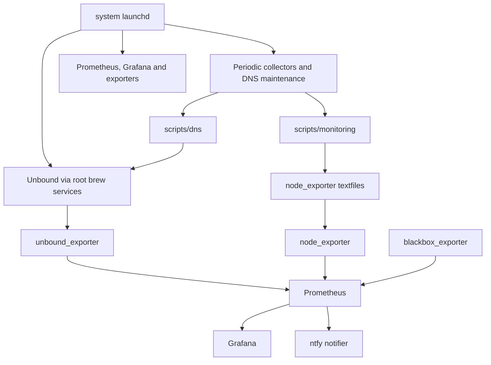

# Architecture optimization audit and migration record

Date: 2026-07-10. Baseline commit: `208c1d7`. Target: `mini.lan` running macOS
26.5.2. This record was produced from repository evidence plus read-only live-host
inspection before implementation.

## Executive finding

The service topology is appropriately layered and SHOULD remain so. Unbound,
Prometheus, Grafana, four exporters or collectors, three DNS maintenance jobs, the
notifier, and cache warming have distinct owners or failure domains. Combining those
components would make failure isolation worse.

The highest operational risk was code placement, not service count: root LaunchDaemons
executed `localadmin`-owned scripts from `/Users/localadmin/warmup` and the Homebrew
configuration prefix. Custom executable code MUST instead be installed root-owned under
`/usr/local/libexec/unbound-stack`. Product configuration SHOULD remain in its native
Homebrew paths; mutable state, generated data, logs, and secrets MUST remain separate
from deployed code.

## Discovery inventory

The baseline repository contained 66 tracked files, 12 runtime scripts, 13 plists
(12 managed definitions and one Homebrew reference), three local Python tools, two test
modules, seven dashboards, one Prometheus rule file, and 68 deployment mappings. Runtime
script code totaled 2,178 lines.

The live host had all 68 manifest entries clean: zero content drift, zero missing files,
and zero unknown results. Six long-running managed services were active. Seven periodic
or boot jobs were loaded. Prometheus exposed eight healthy targets; the node textfile
collector exposed seven producer files with zero scrape errors.

### Dependency graph

### Live drift and unmanaged artifacts

- The manifest comparison was `RESULT: CLEAN` before migration.
- Four prior staging or pre-change files remained under
  `/Users/localadmin/monitoring`; they were absent from the manifest and no loaded job
  referenced them.
- `/opt/homebrew/etc/unbound/unbound.bak` existed live and in the repository but was not
  a deployment mapping. It is a historical rollback copy, not intended configuration.
- Old Grafana stdout/stderr names and the root-hints log used inconsistent paths.
- Homebrew reported no user-managed Prometheus, Grafana, or node_exporter services;
  their system LaunchDaemons were the only active owners. Unbound was root-owned.

## Risks and complexity findings

| Finding | Classification | Evidence | Decision |
|---|---|---|---|
| Root jobs executed user-owned code | Security/reliability | live owner and LaunchDaemon path metadata | Relocate all scheduled code to root-owned libexec |
| Config and scripts mixed under `unbound-etc` | Structural | repository layout and manifest | Separate `config/unbound` and `scripts/dns` |
| Runtime code split across two user-home directories | Structural/trust | live paths and ownership | One libexec root with DNS and monitoring subdirectories |
| Two Screen Sharing scripts implemented one state machine | Duplicate function | same privilege, owner and failure domain | Consolidate to `screenshare on|off` |
| Blocklist reload failure did not restore the prior file | Reliability | updater control flow | Roll back the zone and re-activate the last-known-good copy |
| Personal warm-list replacement was non-atomic and world-readable | Reliability/privacy | shell write path and live mode 0644 | Same-directory temporary file, `localadmin:staff` mode 0600, atomic rename |
| Warmboot/root-hints metrics could leave temp files | Reliability | shell write path | Trap and remove producer-specific temporary files |
| Root-hints log lived outside stack log convention | Structural | plist/newsyslog/live path | Move to `/opt/homebrew/var/log/unbound-roothints.log` |
| Four stale staging files | Operational hygiene | live metadata; no callers | Remove only after successful cutover |
| Repeated two-minute collectors/notifier | Retain | separate data sources and failure domains | Keep schedules; no measurement justified consolidation |
| Three small Python atomic writers | Retain | duplicated helper is small and self-contained | Do not add a shared import/deployment dependency |
| Boot readiness polling | Retain | documented startup race; bounded 90 seconds | Preserve behavior; no proven safer launchd dependency |

## Script classification and migration

| Current path | Target path | Classification | Callers | Rollback |
|---|---|---|---|---|
| `unbound-etc/update-blocklist.sh` | `scripts/dns/update-blocklist.sh` -> libexec | relocate; reliability cleanup | blocklist job, manager, operator | restore old plist/script and zone backup |
| `unbound-etc/blocklist-tui.sh` | `scripts/dns/manage-blocklist.sh` -> libexec | rename/relocate | operator | restore old operator path |
| `scripts/apple_content_cache_exporter.py` | `scripts/monitoring/` -> libexec | relocate | content-cache job | restore old plist/path |
| `scripts/unbound_client_rpz_exporter.py` | `scripts/monitoring/` -> libexec | relocate | clientstats job | restore old plist/path |
| `scripts/prometheus_alert_notifier.py` | `scripts/monitoring/` -> libexec | relocate | alertnotify job | restore old plist/path |
| `warmup/build-warm-list.sh` | `scripts/dns/build-warm-list.sh` -> libexec | relocate; atomic output | warmlist job, operator | restore old plist/path; preserve personal list |
| `warmup/check-blocked.sh` | `scripts/dns/check-warm-list.sh` -> libexec | rename/relocate | operator | restore old path |
| `warmup/warm-at-boot.sh` | `scripts/dns/warm-at-boot.sh` -> libexec | relocate; temp cleanup | warmboot job | restore old plist/path |
| `warmup/warm-unbound-cache.sh` | `scripts/dns/warm-cache.zsh` -> libexec | rename/relocate | warmboot, operator | restore old plist/path |
| `usr-local-sbin/unbound-refresh-hints` | `scripts/dns/refresh-root-hints.sh` -> libexec | rename/relocate | root-hints job | restore old plist/path/log |
| `screenshare-on`, `screenshare-off` | `scripts/maintenance/screenshare.sh` -> sbin | consolidate | operator | restore both prior helpers |

No runtime component was split or rewritten into another language. The distinct
schedules, privilege levels, and failure domains remain intact.

## Target architecture and migration order

1. Validate repository structure, scripts, plist XML, configs, tests, documentation,
   dashboards, deployment mappings, and stale-path searches.
2. Record a Git commit before live changes.
3. Capture service state and a timestamped root-owned rollback bundle containing only
   replaced scripts, plists, public configuration, and ownership/mode metadata.
4. Install root-owned libexec/share directories and stage all replacement files.
5. Run target-host syntax, self-test, `unbound-checkconf`, `promtool`, plist, JSON and
   newsyslog validation before activation.
6. Replace plists and restart only the seven affected jobs. Long-running DNS and
   monitoring services do not require restart for this path-only migration.
7. Run DNS, monitoring, schedule, metadata, drift and stale-path acceptance tests.
8. After acceptance, remove obsolete executable copies and stale stage files while
   retaining the rollback bundle and the generated RPZ `.bak`.

## Behavioral changes

- The Screen Sharing operator interface becomes `screenshare on|off`.
- A failed blocklist reload restores and re-activates the last-known-good zone instead
  of leaving the new file for a future restart.
- Personalized warm-list output is atomically replaced with explicit metadata.
- The private personalized warm list changes from mode 0644 to mode 0600.
- The root-hints job log moves into the common stack log directory.

All DNS policy, service labels, schedules, ports, metric names, textfile names,
Prometheus jobs, Grafana UIDs, and sensitive-state paths remain unchanged.
